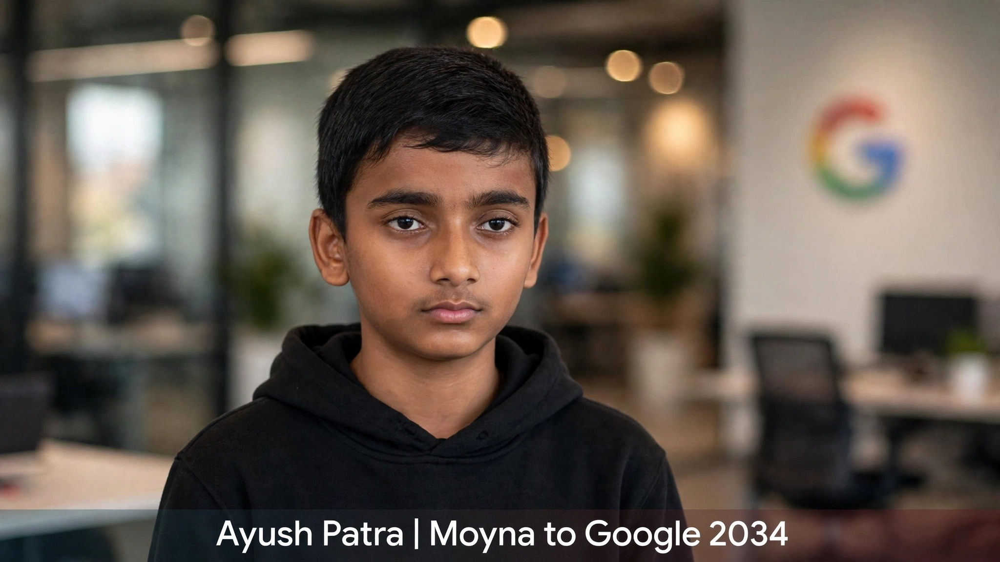

<h1 align="center">Hi, I'm Ayush Patra 👋</h1>
<h2 align="center">Moyna → Google | Crack Year: 2034</h2>

  

  
  
  

---

### 🚀 About Me
🎯 **A 14-year-old boy from Moyna, Purba Medinipur, with a dream bigger than the village.**
I'm a Class 8 student on a mission to become a Google Engineer by 2034. I believe consistency beats talent.

- 🔥 **Daily Grind:** Python, GitHub, Problem Solving
- 🌱 **2026 Target:** 500+ Green Boxes, 20+ Projects
- ✨ **Motto:** Small Village, Big Dreams. Code. Commit. Repeat.

---

### 🛠️ My Stack

  

---

### 📊 My Journey in Numbers

  
  

  

---

### 🗓️ Roadmap: Moyna to Google

| Year | Milestone |
| :--- | :--- |
| **2026** | ✅ GitHub Started, Python Master Journey |
| **2027-29** | 🚧 Class 10 & 12 Topper, Open Source |
| **2030-33** | 💻 B.Tech CSE, DSA & System Design God Mode |
| **2034** | 🎉 **GOOGLE CRACKED - DREAM COMPLETED** |

---

  <i>"Moynar ekta choto chele, ekdin Google er office theke code push korbe. Eta amar promise."</i>
    
  <b>— Ayush Patra, 2026</b>

⭐ If you believe in Moyna to Google, give this repo a Star!

  

